# iPhone Login

I built iPhone Login so I'd have a ready-made sign-in for my iPhone apps.

The iPhone Login is part of my component library that I name Clio
https://github.com/jbailey28/clio. I made the library so I wouldn't keep
rebuilding the same things for every project. It also gives my work more
structure. You can find more on why I built it here.
https://jessykabailey.com/clio-my-personal-component-library/

<!-- Walkthrough video goes here. -->

## What you get

iPhone Login lets the people using your app:

- **Create an account** with their email and a password. They get an email with
  a link to confirm it.
- **Log in** with their email and password.
- **Reset a forgotten password.** They get an email with a link to choose a new
  one.
- **Log in with Google or Apple** instead of typing a password.
- **Stay logged in** after they close the app.

Here's what the pages look like.

<table>
<tr>
<td align="center">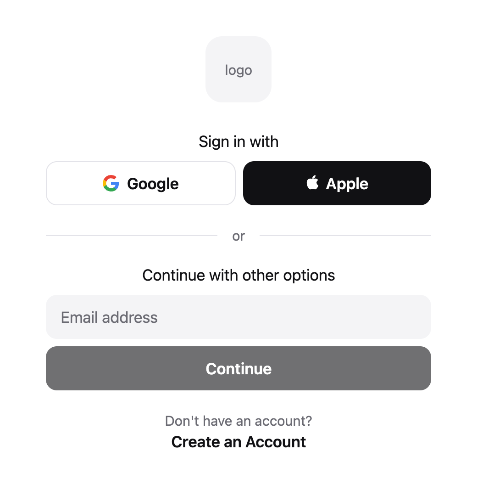<br>Sign in</td>
<td align="center">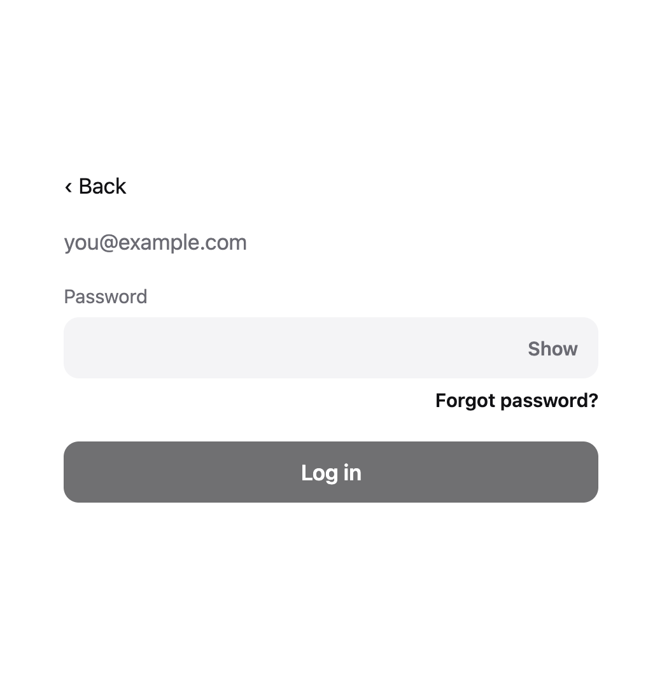<br>Enter password</td>
<td align="center">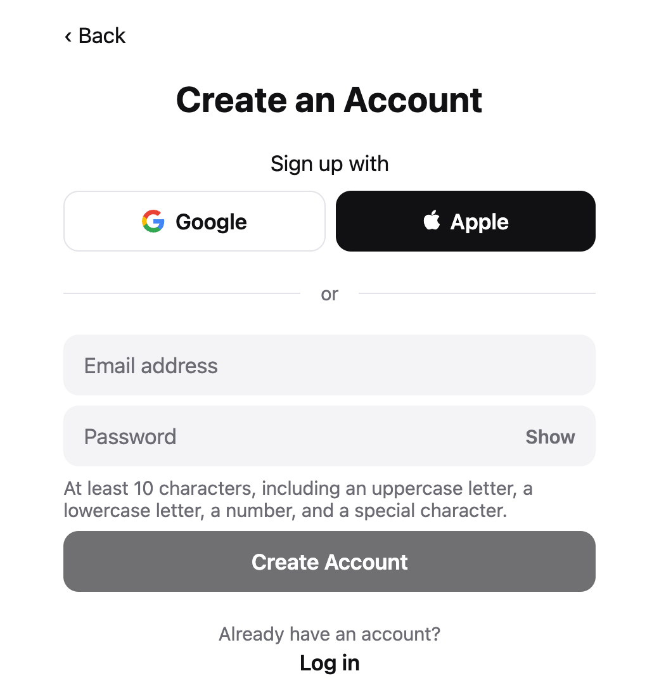<br>Create an account</td>
</tr>
<tr>
<td align="center">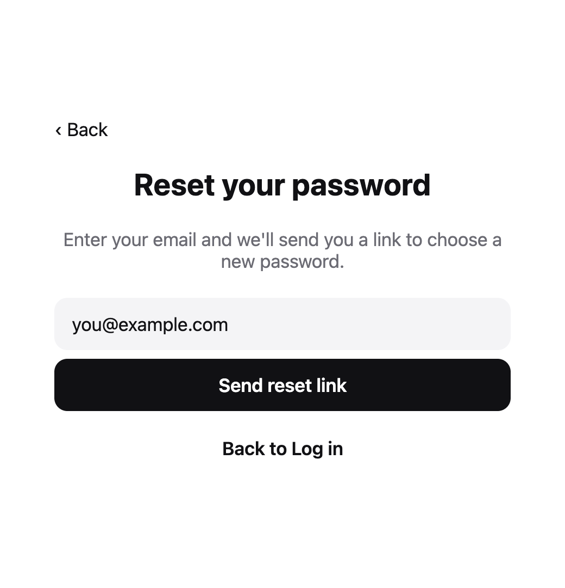<br>Forgot password</td>
<td align="center">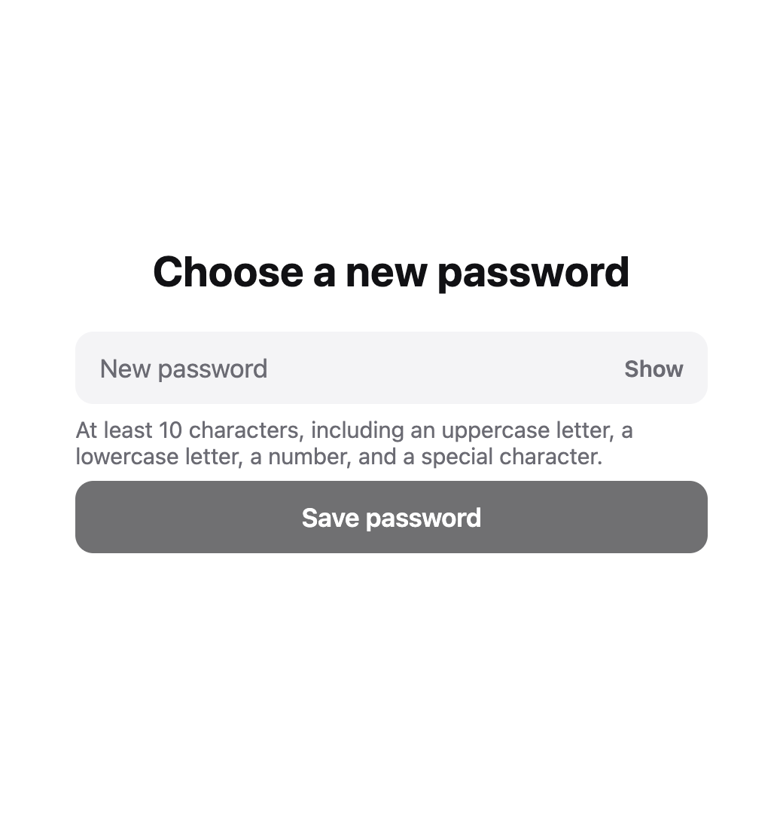<br>Choose a new password</td>
<td></td>
</tr>
</table>

Not shown: "Check your email," which appears after the app sends an email. I
took these screenshots before connecting the app to Supabase, so it couldn't
send an email yet.

It comes with:

- **The four emails** your users get: confirm your email, reset your password,
  your password was changed, and your email was changed.
- **The code that connects it all to Supabase.** If you haven't used Supabase
  before, it's an online service that stores your users' accounts. Its free
  plan lets you have up to two projects.
- **Security testing.** A separate tester tried to break it against 21 security
  rules. The rules are in `SECURITY-REQUIREMENTS.md`, and you can find the
  results in `FINDINGS.md`. You might want to run your own tests too.

It doesn't include:

- **The rest of your app.** After someone logs in, your app shows its own pages.
- **The two web pages the email links open.** You make those on your own
  website. See "What you need" below.

> **Status:** It passes all of its automatic tests and the separate security
> test. It hasn't been tried yet on a real iPhone or with a real Supabase
> account. `GOING-LIVE.md` lists what to check before real people use it.

## What you need

You don't need my component library to use iPhone Login. The library just
makes my own projects easier. Here's what you do need.

**To try it out**

If you did my setup walkthrough (jessykabailey.com/my-setup/), you already
have Claude Code and Homebrew. The one new thing to install is Node.

| What | Why | Cost |
|---|---|---|
| **Claude Code** | It copies iPhone Login into your app and connects it for you. You installed it in the setup walkthrough. | Included with Claude's paid plans |
| **Homebrew** | It's the easiest way to install Node. You installed it in the setup walkthrough. | Free |
| **Node** (new) | Node is a free program that lets your computer run apps written in JavaScript, the language iPhone Login is written in. Expo needs it to build your app and start it on your phone. To install it, open Terminal and type `brew install node`, or ask Claude Code to install it. | Free |
| **Expo** | Expo is a free set of tools for making iPhone apps. You build the app on your computer, and Expo lets you try it on your phone while you work. iPhone Login is built for apps made with Expo. If you don't have an app yet, Claude Code can make one for you. | Free |
| **A Supabase account** | Supabase stores your users' accounts. | Free plan works |
| **The Expo Go app on your iPhone** | It lets you try your app on your phone while you build it. | Free, from the App Store |

**Before real people use it**

| What | Why | Cost |
|---|---|---|
| **Your own website**, with two pages: "Email confirmed" and "Set a new password" | The links in the emails open these pages. | A web address costs about $10–20 a year |
| **An email sending service**, for example Resend | Supabase's own email only sends a few emails an hour. It's only for testing. | Free for small apps |
| **An Apple Developer account** | You need it to put your app in the App Store, and to use Continue with Apple for real. | $99 a year |
| **A Google Cloud account** | Continue with Google needs a sign-in key from Google. | Free |
| **A Cloudflare account** | It adds an "Are you a person?" check to sign-up. That stops fake sign-ups made by computer programs. | Free |

`GOING-LIVE.md` has the full list.

## How to add it to your app

Do these in order. Each step needs the one before it.

### Step 1: Install Node

Open Terminal and type:

```
brew install node
```

When it's done, type `node --version`. If you see a number, like `v24.11.0`,
Node is installed.

### Step 2: Get Expo Go on your iPhone

Open the App Store on your iPhone, search for **Expo Go**, and install it. It's
free. This is how you'll try your app on your phone.

### Step 3: Make your app

Skip this step if you already have an app made with Expo.

1. Make a new, empty folder for your app, for example on your Desktop.
2. Open that folder in Claude Code, and send this message:
   ```
   Make a new Expo app in this folder, then start it so I can open it in Expo Go.
   ```
3. Claude shows a square barcode (a QR code). Point your iPhone's camera at it.
   Your app opens in Expo Go. Your phone and your computer need to be on the
   same Wi-Fi.

You now have a blank app on your phone. Next, you'll give it a place to keep
your users' accounts.

### Step 4: Make a Supabase account and project

1. Go to supabase.com and sign up. It's free.
2. Make a new project. Give it a name, like your app's name.
3. Supabase asks for a database password. Save it somewhere safe, like your
   password manager. You won't need it for this walkthrough.
4. Wait a minute or two while Supabase sets up the project.

### Step 5: Add iPhone Login to your app

In Claude Code, in your app's folder, send this message:

```
Add iPhone Login to my app from https://github.com/jbailey28/iphone-login.
Follow the "For developers" part of its README.
```

Claude copies iPhone Login into your app and connects the sign-in pages. Then
it asks you for two things from your Supabase project. It tells you where to
find them:

- **The project's web address.** It looks like `https://abcd1234.supabase.co`.
- **The publishable key.** It's a long code that's safe to put in an app. Never
  share the key called "secret."

Paste them into Claude Code when it asks.

### Step 6: Set the rules in Supabase

These settings are the rules for your users' accounts. They live in Supabase,
so nobody can get around them by skipping your app.

Open your project on supabase.com and click **Authentication** in the left
menu.

**Sign In / Providers**

Under **User Signups**:

- Allow new users to sign up: **on**
- Confirm email: **on**. People have to tap the link in their email before they
  can log in.

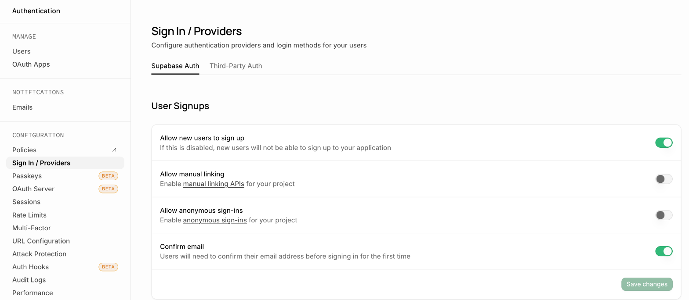

Then click **Email** in the list below it:

- Secure email change: **on**. To change their email, people confirm both the
  old address and the new one.
- Secure password change: **on**. People must have logged in recently to change
  their password.
- Minimum password length: **10**
- Password requirements: **Lowercase, uppercase letters, digits and symbols**
- Enable magic links and email OTP: **off**. This switch lets people log in
  with only an emailed link and no password. iPhone Login doesn't use it, so
  turn it off.
- Email OTP expiration: **900**. This is how long the email links work, in
  seconds. 900 seconds is 15 minutes.

This is how the Email panel looks before you change anything. Click **Save**
at the bottom when you're done.

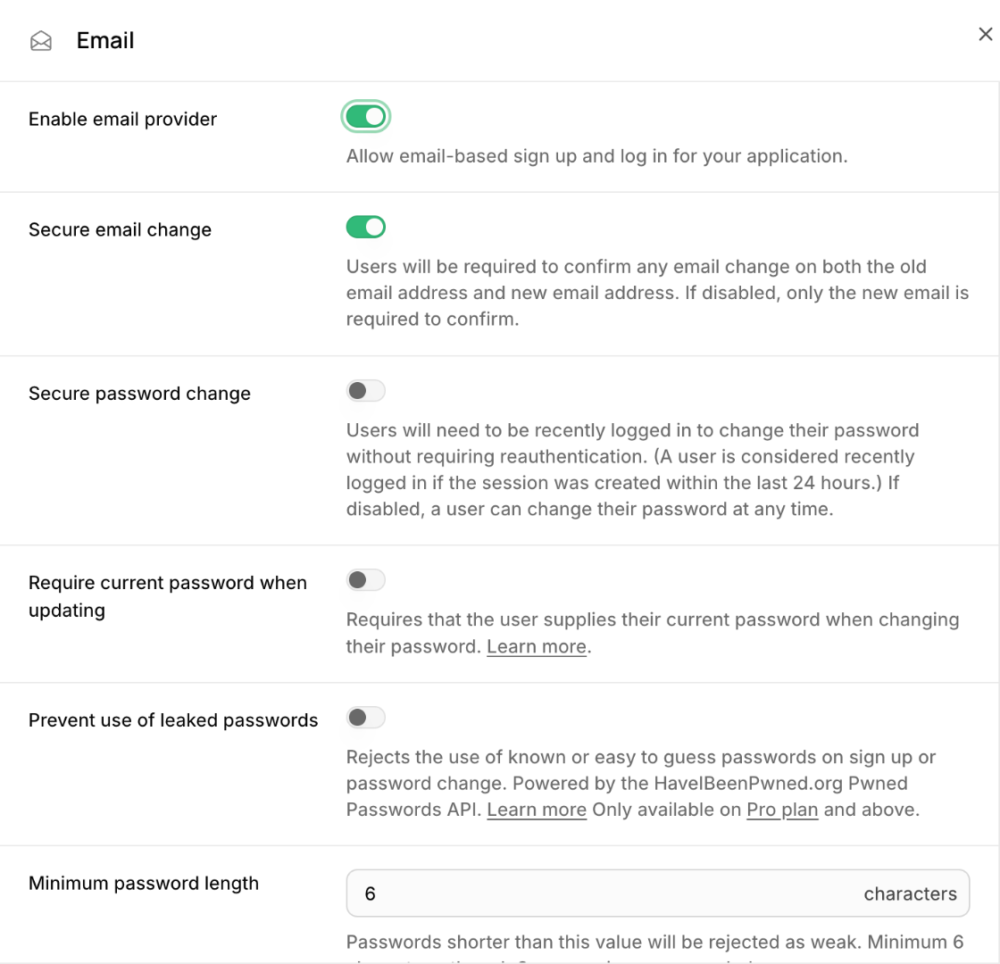

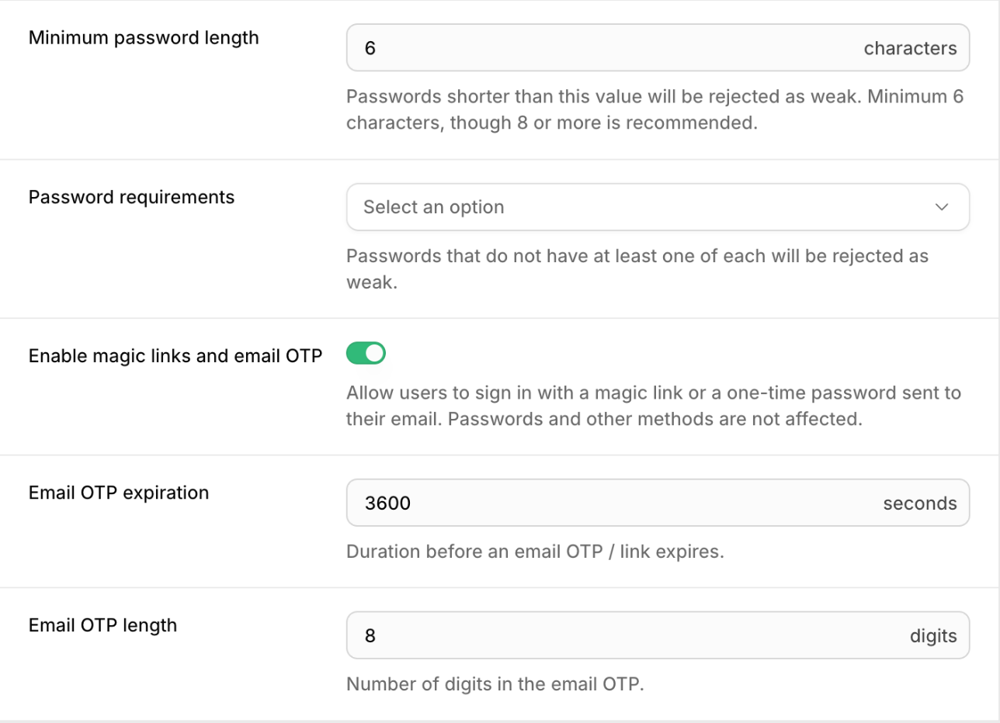

**URL Configuration**

- Site URL: your website's address, for example `https://your-site.com`
- Redirect URLs: these are the addresses Supabase is allowed to send people to.
  Click **Add URL** and add all three:
  - `https://your-site.com/auth/confirm`
  - `https://your-site.com/auth/reset`
  - your app's address for Google sign-in. Claude will tell you what it is.

This is how it looks before you add anything:

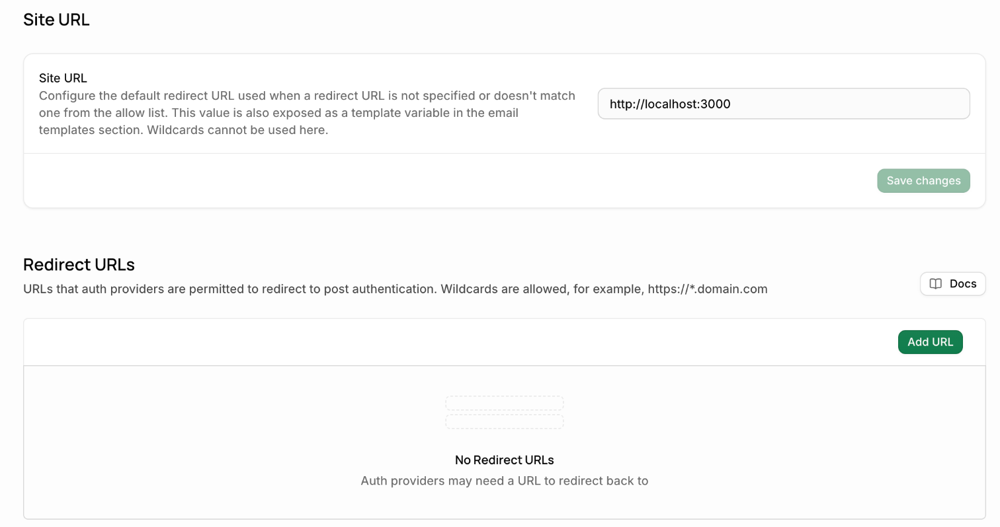

**Emails → Templates**

These are the emails your users get. For each one below, open it, change the
subject, then replace the message with the matching file. The files are on
this GitHub page, in the `supabase/templates` folder.

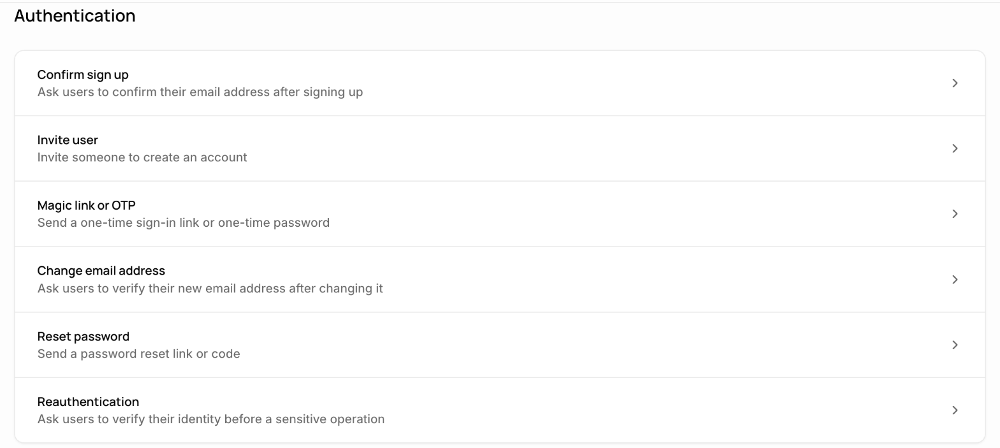

| Email | Subject | File |
|---|---|---|
| Confirm sign up | Confirm your email | `confirmation.html` |
| Reset password | Reset your password | `recovery.html` |

Further down, under **Security**, switch these two on. Then open each one and
do the same:

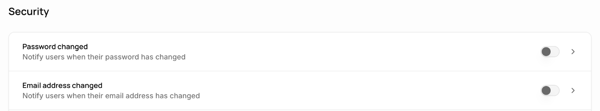

| Email | Subject | File |
|---|---|---|
| Password changed | Your password was changed | `password_changed.html` |
| Email address changed | Your email address was changed | `email_changed.html` |

Use these files, not the emails Supabase starts with. The links in these files
are made to open your app's pages.

### Step 7: Try it on your phone

Ask Claude Code to start your app, and scan the QR code again. You'll see the
sign-in pages in your app.

### Before real people use it

- **Continue with Apple and Continue with Google.** Both are under
  **Sign In / Providers** in Supabase. Each one needs details from Apple or
  Google before you can turn it on. Ask Claude to walk you through it.
- **Your email sending service.** Connect it under **Emails → SMTP Settings**
  in Supabase.
- **The two web pages** on your website that the email links open.

`GOING-LIVE.md` has the full list.

## For developers

You can skip this part. It's for people who want to add iPhone Login by hand,
or change its code.

### Adding it by hand

1. Download this repository (**Code → Download ZIP**) and copy the `src` and `ui`
   folders into your app, for example as `login/src` and `login/ui`.
2. Install what they use:
   ```
   npx expo install @supabase/supabase-js expo-secure-store expo-apple-authentication expo-crypto expo-web-browser expo-linking react-native-svg react-native-safe-area-context
   ```
3. Connect the logins and show the pages:
   ```tsx
   import * as SecureStore from 'expo-secure-store';
   import * as AppleAuthentication from 'expo-apple-authentication';
   import * as Crypto from 'expo-crypto';
   import * as WebBrowser from 'expo-web-browser';
   import * as Linking from 'expo-linking';
   import { SafeAreaProvider, SafeAreaView } from 'react-native-safe-area-context';
   import { createChunkedStorage, createPhoneClient } from './login/src/secureStorage';
   import { createEmailLogin } from './login/src/emailLogin';
   import { createAppleLogin } from './login/src/appleLogin';
   import { createGoogleLogin } from './login/src/googleLogin';
   import { LoginFlow } from './login/ui';

   // Your project's address and publishable key. Never the secret key.
   const supabase = createPhoneClient(SUPABASE_URL, SUPABASE_PUBLISHABLE_KEY, createChunkedStorage(SecureStore));

   const email = createEmailLogin(supabase, {
     confirmUrl: 'https://your-site.com/auth/confirm',
     resetUrl: 'https://your-site.com/auth/reset',
   });
   const apple = createAppleLogin(supabase, {
     randomNonce: () => Crypto.randomUUID(),
     sha256: (s) => Crypto.digestStringAsync(Crypto.CryptoDigestAlgorithm.SHA256, s),
     askApple: (hashedNonce) =>
       AppleAuthentication.signInAsync({
         requestedScopes: [
           AppleAuthentication.AppleAuthenticationScope.FULL_NAME,
           AppleAuthentication.AppleAuthenticationScope.EMAIL,
         ],
         nonce: hashedNonce,
       }),
   });
   const google = createGoogleLogin(supabase, {
     redirectUrl: Linking.createURL('auth/google'),
     openBrowser: (url, redirect) => WebBrowser.openAuthSessionAsync(url, redirect),
   });

   export default function App() {
     const linkUrl = Linking.useURL();
     return (
       <SafeAreaProvider>
         <SafeAreaView style={{ flex: 1 }}>
           <LoginFlow
             supabase={supabase}
             logins={{ email, apple, google }}
             linkUrl={linkUrl}
             signedIn={(session) => <YourHomePage />}
           />
         </SafeAreaView>
       </SafeAreaProvider>
     );
   }
   ```
4. Set up Supabase as in Step 6 above. `supabase/config.toml` holds the same
   settings for a local Supabase.

### How the email links open

For now, the links in the emails open two pages on your website. Once the app
has an Apple Developer account, the same links can open the app directly
(Apple calls this Universal Links). `GOING-LIVE.md` lists what that needs.

### What's in the folder

- `SECURITY-REQUIREMENTS.md`: the 21 things login must never allow. Written
  before any code, on 2026-11-07.
- `GOING-LIVE.md`: what each app has to fill in or set up before real use.
- `FINDINGS.md`: what the security tester found, and what was decided.
- `src/emailLogin.ts`: email and password login, sign-up, forgot password, log
  out.
- `src/appleLogin.ts`: Continue with Apple.
- `src/googleLogin.ts`: Continue with Google, through Google's own sign-in page.
- `src/secureStorage.ts`: keeps the login in the iPhone's secure storage (the
  Keychain), split into pieces small enough to fit.
- `ui/`: the sign-in pages, and `LoginFlow`, which shows them in order.
- `supabase/config.toml` and `supabase/templates/`: the Supabase settings and
  the emails.
- `tests/`: the builder's tests. `tests/ui/` clicks through the pages.
- `.devcontainer/`: the setup for running the tests in a GitHub codespace.

### Running the tests

Install with:

```
npm install --legacy-peer-deps
```

The extra flag works around a bug in npm with this version of the test tool.

`scripts/test-in-codespace.sh` runs every test in a GitHub codespace, not on
your computer. The tests also run on GitHub Actions every time the code
changes. You need Node 22 and Docker, or a GitHub account.

### How it's tested

- It was built with Claude Opus.
- It was security-tested with Claude Fable, in a separate, fresh codespace that
  held only this code and the security requirements.
- Supabase runs inside the codespace and is thrown away after each run. No real
  Supabase project is used.
- The final check runs on GitHub Actions on every change.

### What never goes in this repository

- Builder notes. The security tester sees only the code and the requirements.
- Keys, passwords, or `.env` files.

## License

MIT. Anyone can use, copy and change it for free. See `LICENSE`.
